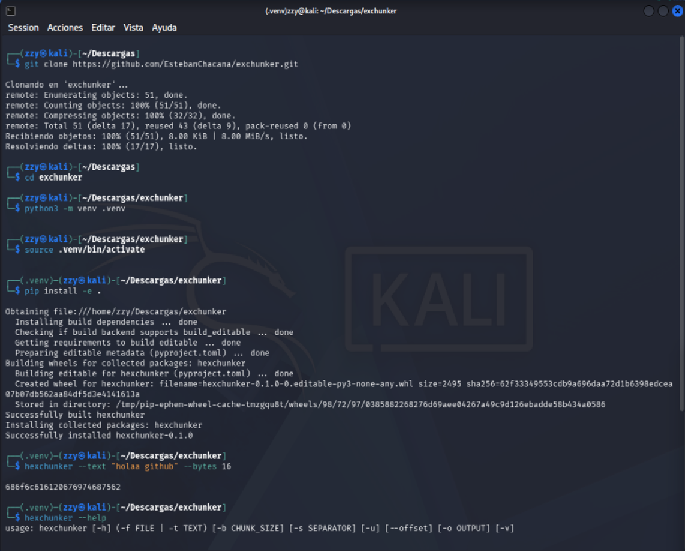

## Sobre este proyecto

Soy estudiante de primer año de Ingenieria en Informática y arme esta herramienta para
aprender como se organiza un proyecto de Python "en serio".

La estructura base y el código inicial los genere con ayuda de Claude.
aunque me puse a leer función por función hasta
entender que hacia cada una, arme el entorno virtual a mano, corri los tests
para ver que no se rompiera nada, y fui agregando comentarios propios a medida
que entendia el porque de cada parte. Todavía me falta mucho, pero esta fue mi
forma de hacer un proyecto real.

Si ves algo mejorable (seguro hay varias cosas, apenas estoy empezando), los
issues y sugerencias son bienvenidos. 


## Cómo usarlo

### 1. Clona el repo

```bash
git clone https://github.com/EstebanChacana/exchunker.git
cd exchunker
```

### 2. Crea un entorno virtual

```bash
python3 -m venv .venv
source .venv/bin/activate
```

### 3. Instala el proyecto

```bash
pip install -e .
```

### 4. Úsalo

```bash
hexchunker --text "Hola mundo" --bytes 4
hexchunker --file algo.txt --bytes 16
hexchunker --text "Hola" --bytes 4 --separator " " --uppercase
hexchunker --file algo.txt --output salida.hex
hexchunker --help
```

### Ejemplo en terminal
